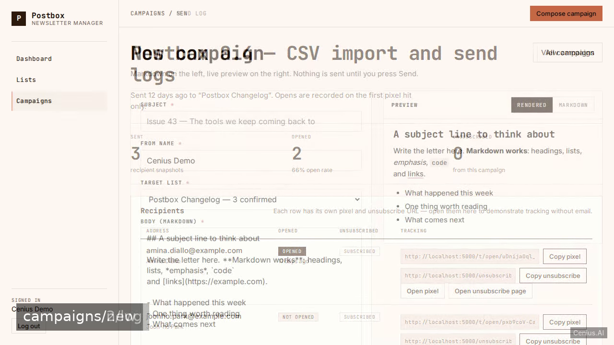
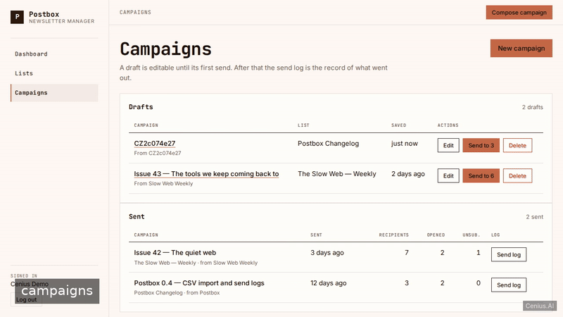
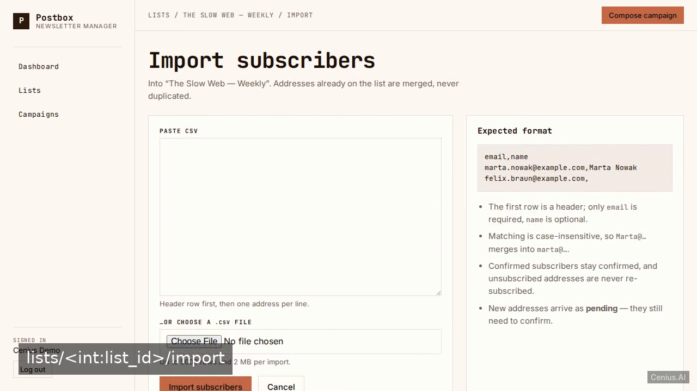

# Postbox Newsletter Manager — complete Flask web application example app

A Flask web application, open-source and ready to self-host: that's **Postbox Newsletter Manager**. Postbox is a self-hosted, Mailchimp-replacement newsletter manager built with Flask, Jinja2 templates under templates/ and SQLite via the sqlite3 stdlib, aimed at bloggers and small projects. Postbox Newsletter Manager ships complete — source, design assets, seed data — under the Apache-2.0 license; no cloud account needed. [Remix Postbox Newsletter Manager on cenius.ai](https://cenius.ai/marketplace/p/postbox-newsletter-manager?ref=gh&utm_campaign=postbox-newsletter-manager-flask) for a custom build.


[](LICENSE)  [](https://cenius.ai)

[](https://cenius.ai/marketplace/p/postbox-newsletter-manager?ref=gh&utm_campaign=postbox-newsletter-manager-flask)

> **▶ [Open & edit in cenius.ai](https://cenius.ai/marketplace/p/postbox-newsletter-manager?ref=gh&utm_campaign=postbox-newsletter-manager-flask)** — one click to an editable workspace: describe changes in plain English, get an instant preview, one-click deploy and host. Modifications made on the platform come with full rebrand & relicense rights.

_Local clone? See [Quick start](#quick-start) below. cenius.ai is the zero-setup path._

## Demo





📽 **[Watch the walkthrough](https://cenius.ai/marketplace/p/postbox-newsletter-manager?ref=gh&utm_campaign=postbox-newsletter-manager-flask)** — plays on cenius.ai · [MP4 file](.github/media/demo.mp4)

## Screenshots

  

## Features

- Email/password sign-in with seeded demo account
- Subscriber lists CRUD
- Subscribers inside a list
- Double opt-in confirmation tokens
- Campaign composer with Markdown and live preview
- Simulated send log with open and unsubscribe counts
- Subscriber CSV import with duplicate merging
- Dashboard

## Quick start

```bash
./install.sh   # installs dependencies + seeds demo data
```

See [`INSTALL.md`](INSTALL.md) for full setup and usage instructions.

## Architecture

The repository contains 80 files of Flask source, organised under `app/`, `instance/`, `static/`, `templates/`, `tests/`, `tools/`. Starting up is just `./install.sh`: it installs what is needed and pre-fills the database so you have data to work with straight away. Full setup details: [`INSTALL.md`](INSTALL.md).

## Usage guide

### Overview

This is **Postbox Newsletter Manager** — an HTTP API + web UI. This document covers the surface area you can use, with copy-pasteable examples for each entry point. For setup, see `INSTALL.md`.

### Quickstart

After completing the install steps in `INSTALL.md`:

```bash
flask --app app run --debug    # start the server
## in another terminal:
curl http://localhost:8000/health
```

### Endpoints

Every endpoint below was extracted from the source by the route scanner (Next.js / FastAPI / Flask / Django / Express).

| Method | Path | Source file |
|--------|------|-------------|
| `GET` | `/health` | `app/__init__.py` |
| `GET` | `/campaigns/<int:campaign_id>/edit` | `app/campaigns.py` |
| `GET` | `/campaigns/new` | `app/campaigns.py` |
| `GET` | `/confirm/<token>` | `app/public.py` |
| `GET` | `/lists/<int:list_id>/import` | `app/importer.py` |
| `GET` | `/login` | `app/auth.py` |
| `GET` | `/register` | `app/auth.py` |
| `GET` | `/unsubscribe/<token>` | `app/public.py` |

#### curl examples

##### `GET /health`

```bash
curl http://localhost:8000/health
```

##### `GET /campaigns/<int:campaign_id>/edit`

```bash
curl http://localhost:8000/campaigns/<int1>/edit
```

##### `GET /campaigns/new`

```bash
curl http://localhost:8000/campaigns/new
```

##### `GET /confirm/<token>`

```bash
curl http://localhost:8000/confirm/<token>
```

##### `GET /lists/<int:list_id>/import`

```bash
curl http://localhost:8000/lists/<int1>/import
```

### Worked example

1. Boot the server (`flask --app app run --debug`).
2. Hit a smoke-test endpoint:

_Full guide: [`USAGE.md`](USAGE.md)_

## FAQ

### What does it take to self-host Postbox Newsletter Manager?

Grab the repo and run `./install.sh` — it handles packages and seed data in one go. After that, [`INSTALL.md`](INSTALL.md) walks you through starting the server. No external accounts required.

### Can non-developers customise Postbox Newsletter Manager?

Yes — [load it on cenius.ai](https://cenius.ai/marketplace/p/postbox-newsletter-manager?ref=gh&utm_campaign=postbox-newsletter-manager-flask), describe the change in plain English, and you get back a fresh build with your modification applied.

### Which framework or language does Postbox Newsletter Manager use?

The app is built with Flask. What you see in this repo is the full production source, demo data included. Highlights include subscriber CSV import with duplicate merging.

### Can I use Postbox Newsletter Manager in a commercial project?

Yes — it ships under the Apache-2.0 license, which permits commercial use, modification and redistribution. The full text is in [LICENSE](LICENSE).

### Can I rebrand or white-label Postbox Newsletter Manager?

Yes — and the easiest way is [remixing it on cenius.ai](https://cenius.ai/marketplace/p/postbox-newsletter-manager?ref=gh&utm_campaign=postbox-newsletter-manager-flask): modifications made on the platform come with full rebrand and relicense rights over your derivative.

## License & rebranding

Released under the [Apache License 2.0](LICENSE) (© 2026 Cenius AI) — free for personal and commercial use. The Cenius name/logo are trademarks (see NOTICE).

**Need a customized version?** [Remix this app on cenius.ai](https://cenius.ai/marketplace/p/postbox-newsletter-manager?ref=gh&utm_campaign=postbox-newsletter-manager-flask) — modifications made on the platform come with **full rebrand & relicense rights** over your derivative.

## Built with cenius.ai

This entire application — code, design, seeded demo data — was generated on **[cenius.ai](https://cenius.ai)** from a plain-English description.

- 🚀 [Build your own app on cenius.ai](https://cenius.ai)
- 🎛️ [Remix Postbox Newsletter Manager on the marketplace](https://cenius.ai/marketplace/p/postbox-newsletter-manager?ref=gh&utm_campaign=postbox-newsletter-manager-flask) — open it in a workspace, prompt for changes, and ship your own version.

More open-source apps: [the Cenius-ai catalog](https://github.com/Cenius-ai) · [showcase index](https://github.com/Cenius-ai/showcase)
